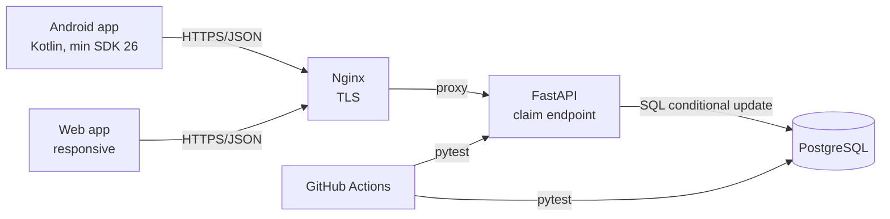

# System Overview

## Design decisions

1. **Self-hosted backend.** FastAPI runs on the team's Ubuntu server behind Nginx with TLS. This gives full control over the claim transaction and avoids vendor lock-in. The cost is that the team operates TLS certificates, backups and authentication.
2. **One OpenAPI contract for both clients.** The Android and web clients use the same endpoints and field names. The schema is fixed before UI work, and both clients are tested against the same API fixtures.
3. **SQL conditional update.** A claim is `UPDATE items SET remaining = remaining - :qty WHERE id = :id AND remaining >= :qty`. If no row is updated, the API returns `409 Conflict`. The check and the decrement happen in one statement, so two users cannot both claim the last unit.
4. **Integer quantities.** All quantities are integers, so the invariant needs no floating-point tolerance and can be asserted exactly in tests.
5. **Prototype authentication.** `X-User-Id` is used during the prototype so the claim rule can be tested without a login flow. JWT authentication is planned for Iteration 1.
