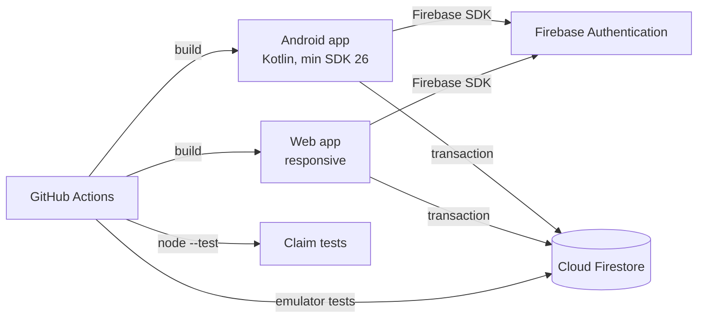

# System Overview

## Design decisions

1. **Managed Firebase backend.** Authentication, storage and offline support are provided by Firebase. This removes deployment and backup work from a one-month project. The trade-off is vendor lock-in; the clients depend on a repository interface so the backend can be replaced later.
2. **One data model for both clients.** The item document is `{ id, name, total, remaining, claims }`, and both clients use the same field names and integer quantities. The schema and repository contract are fixed before UI work; both clients run against the same emulator fixtures.
3. **Transaction-based claim.** A claim reads `remaining`, validates the quantity, decrements it and writes the claim in one Firestore transaction. The losing request receives a conflict instead of producing a negative quantity.
4. **Integer quantities.** All quantities are integers, so the invariant needs no floating-point tolerance and can be asserted exactly in tests.
